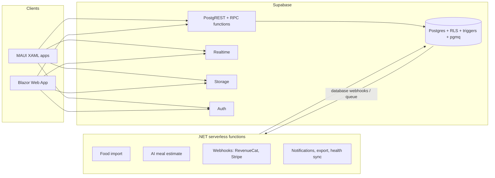
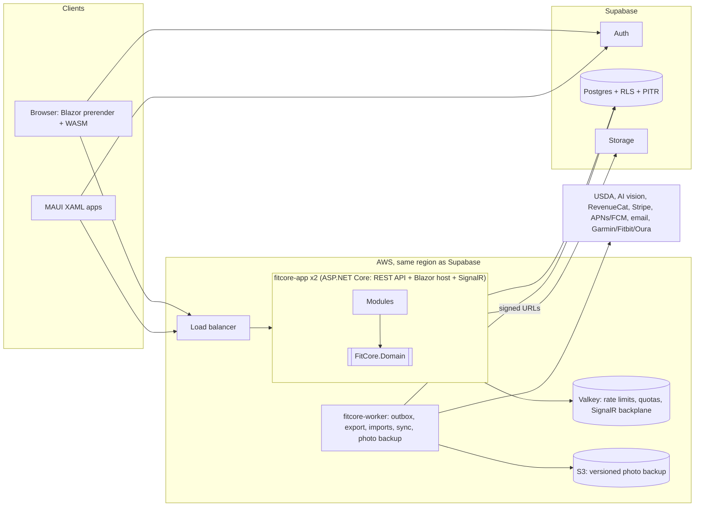
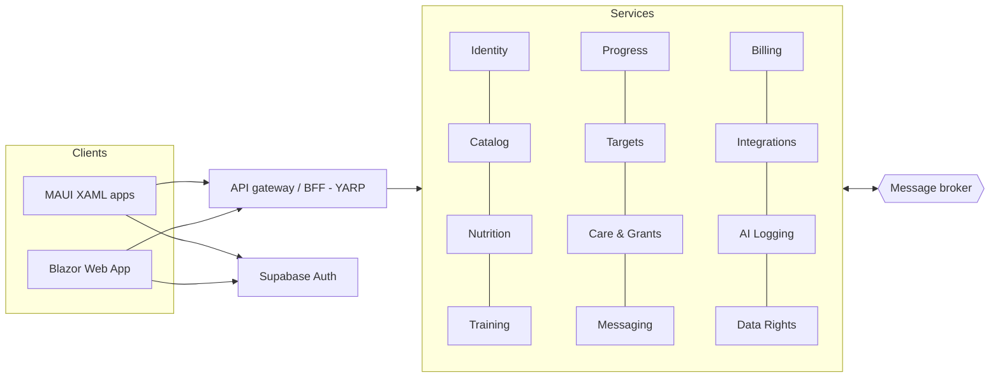

# Architecture Options: FitCore

- **Status:** Proposal v2, revised against the measurable NFRs in [`NFR.md`](NFR.md). The product owner accepted Option B on 2026-10-13.
- **Decision record:** [ADR 0003](decisions/0003-modular-monolith.md) (accepted)
- **Date:** 2026-10-13
- **Input:** [`BRD.md`](BRD.md) (especially [§3](BRD.md#3-permissions), [§5](BRD.md#5-platform-and-technology-constraints), [§6](BRD.md#6-business-rules) and [§7](BRD.md#7-compliance-and-constraints)) and [`NFR.md`](NFR.md)

This document proposes three architecture options for FitCore. It checks each one against the business requirements and the NFR IDs in [`NFR.md`](NFR.md), including a cost check against the launch budget, and recommends one.

---

## 1. Starting point

### 1.1 What the BRD already fixes

Every option keeps these choices:

| Area | Fixed by the BRD |
|---|---|
| Clients | .NET MAUI apps with native XAML on iOS, Android, Windows and macOS, and a Blazor Web App on the web. Both UIs share view models, service clients and the domain library. |
| Domain logic | One shared C# library for units, nutrition totals, estimated cost, targets and guardrails |
| Data platform | Supabase: Postgres, Auth, Storage and row-level security (RLS) |
| Server logic | ASP.NET Core services |
| Sign-in | Email/password, Google, Microsoft and Sign in with Apple |

The options differ in where business rules are enforced (Postgres or .NET), how the server is split, and how clients reach the data.

### 1.2 NFRs that decide the architecture

Most NFRs are met the same way in every option, for example accessibility (NFR-ACC) and localization (NFR-L10N). These are the ones that separate the options:

| NFR | Target | What it forces in the architecture |
|---|---|---|
| [NFR-CST-1](NFR.md#15-cost), [NFR-CST-3](NFR.md#15-cost) | **≤ $500/month in total** at launch, AI included and capped at $150 | Few always-on parts. Rules out heavy platform infrastructure (Kubernetes, a broker, a database per service). |
| [§1.1 sizing](NFR.md#11-sizing-assumptions), [NFR-SCL-1](NFR.md#4-scalability-and-capacity) | 50 req/s at launch, 10× (500 req/s) without a redesign | Modest load. Any option here reaches 10× by adding instances and a larger database. |
| [NFR-AVL-1](NFR.md#2-availability-and-recovery), [NFR-AVL-3/4](NFR.md#2-availability-and-recovery) | 99.5% per month, RPO ≤ 1 h, RTO ≤ 8 h | Single region is enough. Needs point-in-time recovery (PITR), plus a separate backup of Storage objects (Supabase database backups don't include them). |
| [NFR-AVL-6](NFR.md#2-availability-and-recovery) | A vendor outage degrades only its own feature | Timeouts and circuit breakers on every integration, and food search served from our own database |
| [NFR-PRF-1..3](NFR.md#3-performance) | p95: reads 300 ms, writes 500 ms, food search 800 ms | Compute in the same region as Supabase. USDA data imported in bulk and searched locally, not fetched live. |
| [NFR-PRF-8](NFR.md#3-performance) | Web: LCP ≤ 2.5 s, INP ≤ 200 ms | Blazor needs prerendering. A WebAssembly-only first load is too slow. |
| [NFR-SCL-2](NFR.md#4-scalability-and-capacity) | Stateless, horizontally scalable services | No Blazor Interactive Server circuits. Rate limits, quotas and real-time fan-out need shared state, not per-instance memory. |
| [NFR-SCL-5](NFR.md#4-scalability-and-capacity), [NFR-CST-3](NFR.md#15-cost) | Token-bucket limits per member, per IP and per endpoint class; AI quota per member per local day | Requires a server-side request path that can count per member. Supabase's Data API (PostgREST) has no per-member rate limiting. |
| [NFR-PRV-1..5](NFR.md#7-privacy-and-access-control) | RLS on every table; pgTAP for six actors; revocation on the **next request**; device cache cleared within 1 min online and ≤ 24 h offline | Grant checks must read live state. The sync protocol must carry grant status. |
| [NFR-PRV-6](NFR.md#7-privacy-and-access-control) | No health data in logs, analytics, crash reports or push payloads | One logging pipeline with a redaction allow-list. Push payloads carry IDs only. |
| [NFR-REL-3](NFR.md#5-reliability-and-data-integrity) | Idempotent sync, zero duplicates, last writer wins, the member is told when their change was overwritten | A sync endpoint with client UUIDs and record versions that reports conflicts back to the device |
| [NFR-DAT-1](NFR.md#8-data-retention-export-and-deletion), [NFR-PRF-12](NFR.md#3-performance) | ZIP export (CSV, photos, manifest) in ≤ 15 min | A long-running background job. Too close to AWS Lambda's 15-minute hard limit. |
| [NFR-DAT-2](NFR.md#8-data-retention-export-and-deletion) | Deleted from primary stores in 30 days, from backups in 35 | All backup retention (PITR and the Storage copy) has to stay under 35 days |
| [NFR-AUD-1..3](NFR.md#9-auditability) | Append-only audit; no one can edit or delete it | Audit written in the same transaction; database grants that block `UPDATE` and `DELETE` for every app role |
| [NFR-CMP-5](NFR.md#12-compatibility-and-platforms) | Old app versions keep working ≥ 90 days; versioned APIs | A versioned API contract, separate from the database schema |
| [NFR-MNT-1](NFR.md#13-maintainability-and-quality), [NFR-MNT-4](NFR.md#13-maintainability-and-quality) | Domain library ≥ 90% coverage; business logic only in the shared library or the server | One implementation of the rules, ideally the same code on the client and the server |
| [NFR-OPS-4](NFR.md#10-observability-and-operations), [NFR-OPS-6](NFR.md#10-observability-and-operations) | 1-hour on-call response; rollback in ≤ 30 min; forward-only migrations | Few deployables. Expand-then-contract migrations so the previous app version still runs after a rollback. |

---

## 2. Option A: Supabase-first serverless

The clients talk to Supabase directly. Postgres holds the data, the authorization and the business rules. Small .NET serverless functions do only what Postgres can't: integrations and webhooks.



### A.1 Architecture style

Serverless with a backend-as-a-service. Supabase's Data API (PostgREST), Realtime and Storage are the backend. Supabase Edge Functions run on Deno, not .NET, so the ASP.NET Core logic runs as .NET functions on AWS Lambda (Native AOT or SnapStart) or Azure Functions (isolated worker).

### A.2 Project structure and boundaries

```text
src/
  FitCore.Domain/          shared rules (client-side preview and table tests)
  FitCore.Client.Core/     view models, supabase-csharp data access, offline store
  FitCore.Maui/            XAML app
  FitCore.Web/             Blazor Web App
  FitCore.Functions/       one function per integration or webhook
supabase/
  migrations/              tables, RLS, RPC functions, triggers
  tests/                   pgTAP: RLS and guardrail functions
```

Boundaries are Postgres schemas and RPC functions. Each business operation that must enforce a rule is a `security definer` function, such as `set_target()`, `accept_target()` or `grant_access()`.

### A.3 Database and schema approach

- One Supabase project. Schemas group the tables (`nutrition`, `training`, `progress`, `care`, `catalog`, `audit`), and the Data API exposes them.
- RLS on every table, with a `care.has_grant(member_id, scope)` helper.
- **The guardrails are rewritten in PL/pgSQL.** The C# library still runs on the client for previews, so the rules exist in two languages.
- Snapshots and audit rows are written by triggers. Background work runs on pgmq queues or database webhooks that call the functions.

### A.4 API design

PostgREST REST for CRUD, RPC (`POST /rpc/...`) for operations that carry rules, Supabase Realtime for messages, and HTTP functions for webhooks. The team owns no API contract: the database schema is the contract.

### A.5 Authentication and authorization

Supabase Auth with the Email, Google, Azure (Microsoft) and Apple providers. A Custom Access Token Hook adds an `app_role` claim. **RLS is the only authorization layer.** Policies check the role, the grant scope and the MFA level (`aal2`). Rate limiting exists only on Supabase Auth endpoints.

### A.6 Deployment model

Managed Supabase (staging and production), functions on Lambda in the same AWS region, Blazor WebAssembly on a CDN, and the apps in the three stores.

### A.7 Evaluation

| | |
|---|---|
| **Pros** | Lowest cost and least to operate. Fastest to the private beta. One authorization model, applied on every path. Revocation is immediate because policies read the live grant table. Reuses the R1 prototype's schema and pgTAP tests almost as they are. |
| **Cons** | Rules exist in two languages, which invites drift in the safety rules. No per-member rate limiting or AI quota on the data path. The schema is the public API, so mobile clients break when it changes. Long jobs hit the Lambda 15-minute limit. Complex coaching workflows get hard to write in SQL. The C# Supabase client is community-maintained. |
| **NFRs met** | NFR-CST-1 (the cheapest option), NFR-PRV-1/2/3/4 (server side), NFR-AUD-1..3 (triggers), NFR-AVL-1/3/4 (through Supabase PITR) |
| **NFRs at risk** | **NFR-SCL-5** (per-member and per-endpoint rate limits on the Data API would need a counter write on every request), **NFR-CMP-5** (schema changes break old app versions), **NFR-MNT-1/4** (rules duplicated in PL/pgSQL), **NFR-PRF-12** (15-minute export against Lambda's 15-minute limit), NFR-OPS-1 (logic split across SQL and functions is hard to trace), NFR-SEC-1 (ASVS L2 controls such as rate limiting and input validation are spread across SQL) |
| **Team** | 2–4 engineers, with strong Postgres skills (RLS, PL/pgSQL, pgTAP) |
| **Complexity** | **Low** for the beta, rising to **high** by the Coach/Pro tier |

---

## 3. Option B: Modular monolith on ASP.NET Core, with Supabase as the data platform

A single ASP.NET Core application, split into strict modules, owns every business operation and runs the shared C# domain library on the server. Supabase provides Postgres, Auth and Storage. RLS stays in force as a second, independent layer.



### B.1 Architecture style

**Modular monolith.** The application ships as one container image with two process types: `app` (API and Blazor host) and `worker` (background jobs). Each module owns its tables and exposes only a public interface and integration events. Architecture tests in CI stop one module from reaching into another's internals.

### B.2 Project structure and boundaries

```text
src/
  FitCore.Domain/               shared rules: units, totals, cost, targets, guardrails (no I/O)
  FitCore.Contracts/            request/response DTOs and the typed API client, versioned (/v1)
  FitCore.Client.Core/          view models (MVVM), encrypted offline store, sync engine
  FitCore.Maui/                 XAML app, HealthKit / Health Connect bindings
  FitCore.Web/                  Blazor Web App host (static SSR + prerendering), also hosts the API
  FitCore.Web.Client/           Blazor WebAssembly interactive components
  FitCore.Worker/               background host: outbox dispatcher, scheduled and long jobs
  FitCore.Platform/             cross-cutting: auth, RLS session, rate limits, redacted logging, resilience
  Modules/
    FitCore.Modules.Identity/   profile, age gate, roles, consents (NFR-PRV-7)
    FitCore.Modules.Catalog/    shared and custom foods and exercises, USDA bulk import and search, admin curation
    FitCore.Modules.Nutrition/  diary, snapshots, recipes, saved meals, planner, groceries, purchases
    FitCore.Modules.Training/   workouts, templates, programs, PRs, training load
    FitCore.Modules.Progress/   weight, measurements, photos, wellness, adaptive-target proposals
    FitCore.Modules.Targets/    estimates, guardrails, overrides, acceptance, precedence
    FitCore.Modules.Care/       grants and scopes, roster, plan assignment, comments, check-ins, messaging
    FitCore.Modules.Sync/       offline sync protocol, conflict reporting, grant-status delivery
    FitCore.Modules.Billing/    entitlements (RevenueCat), coach billing (Stripe Connect)
    FitCore.Modules.Integrations/ AI vision with quotas, health-platform and device sync, calendar, notifications
    FitCore.Modules.DataRights/ export, import (MyFitnessPal), deletion
    FitCore.Modules.Audit/      audit queries and the member-visible audit view
supabase/
  migrations/                   SQL migrations, forward-only (NFR-OPS-6)
  tests/                        pgTAP: RLS for the six actors in NFR-PRV-2
tests/
  FitCore.Domain.Tests/         table tests for BRD §6, ≥ 90% coverage (NFR-MNT-1)
  FitCore.Modules.*.Tests/      module tests against a local Supabase stack
  FitCore.Architecture.Tests/   module boundaries; no business logic in UI projects (NFR-MNT-4)
  FitCore.Load.Tests/           3× peak load test (NFR-SCL-1)
```

Modules call each other only through their contracts, in process. Side effects that cross modules (for example "target accepted" → notify the coach) go through a **transactional outbox** that the worker dispatches.

### B.3 Database and schema approach

- **One Supabase Postgres database with one schema per module**, named after the module in snake case: `identity`, `catalog`, `nutrition`, `training`, `progress`, `targets`, `care`, `sync` (device cursors, conflict records, grant leases), `billing`, `integrations`, `data_rights` (export and deletion jobs) and `audit`. A module reads and writes only its own schema.
- **Supabase CLI SQL migrations** are the single schema source, so RLS and pgTAP sit next to the tables and the R1 work carries over. Migrations follow expand-then-contract, so the previous release still runs after a rollback (NFR-OPS-6).
- **RLS stays on for API traffic.** For each request, the API opens a transaction, switches to the `authenticated` role and sets `request.jwt.claims` from the caller's validated token. A bug in the API still can't read another member's rows. A few jobs use separate privileged credentials: catalog import, webhooks, deletion and export.
- **Key tables:**
  - `care.relationships`: member, professional, role, `scopes text[]`, status, granted and revoked timestamps
  - `targets.targets`: `set_by`, `state` (pending, accepted, superseded), `below_soft_limit`, `below_hard_floor`
  - `nutrition.diary_entries`: client UUID, a `version` column, nutrient snapshots in nullable columns (null means unknown, NFR-REL-5), cost as `bigint` minor units plus `char(3)` currency (NFR-REL-6)
  - `audit.events`: written by triggers in the same transaction. App roles have `INSERT` and `SELECT` only (NFR-AUD-3). Pseudonymized after account deletion and kept 6 years (NFR-DAT-4).
- **Food search:** the USDA FoodData Central bulk dataset is imported into `catalog` and searched with Postgres full-text and trigram indexes. Search never waits on a live USDA call (NFR-PRF-3, NFR-AVL-6).
- **Backups:** Supabase PITR for the database (RPO ≤ 1 h). Supabase database backups don't include Storage objects, so the worker copies each new photo to a versioned, encrypted S3 bucket in the same region, triggered through the outbox. Old versions expire after 30 days, within the 35-day deletion window (NFR-AVL-3, NFR-DAT-2).
- **Deletion:** photo objects and their backups are keyed under a per-member prefix (`members/{member_id}/`). Account deletion removes the member's Storage objects, then lists every S3 object version and delete marker under that prefix and deletes each one by version ID, so nothing is left for the 30-day expiry to catch. A deletion test checks that no current or old version remains, and the expiry rule is the safety net that keeps backups inside the 35-day limit (NFR-DAT-2).
- **Data API:** the Supabase Data API (PostgREST) is switched off for module schemas. The FitCore API is the only way in.

### B.4 API design

- **REST + OpenAPI**, versioned under `/v1`, with ASP.NET Core minimal APIs. Both UIs use one typed client from `FitCore.Contracts`. Each released client version is pinned to an API version that stays supported for at least 90 days (NFR-CMP-5).
- **Guardrails as a protocol:** for example, `POST /v1/targets` returns `422 ProblemDetails` with `target.below_soft_limit` and a warning ID. The client resends with `acknowledgedWarningId`, and the override is audited. A hard-floor violation returns `403` for members and coaches.
- **Sync:** `POST /v1/sync` takes batched changes keyed by client UUID with the record version the device last saw. It upserts idempotently, applies last-writer-wins, and returns conflicts so the app can tell the member (NFR-REL-3). The same response carries the **grant status** for a professional's devices, so revoked data is purged at the next sync (NFR-PRV-4).
- **Offline grant expiry:** each grant status in the sync response carries a server-issued `validUntil` (last successful check + 24 hours). `FitCore.Client.Core` stores it in the encrypted store with the device's monotonic (time-since-boot) clock reading and the wall-clock time, and updates both while the app runs. It also stores a boot-session identifier: the OS boot counter on Android, and the kernel boot time on iOS, macOS and Windows. The check fails closed. The lease counts as expired if the boot session has changed (the device rebooted, whatever its uptime is now), if the monotonic reading is lower than the stored one, if the wall clock has moved backwards, or if the platform can't provide a boot-session identifier, because clock continuity can't be proven. Restarts, reboots and clock changes can therefore only shorten the lease, never extend it. Before showing any cached member data, the app checks the lease. Once it has expired, the app denies access and deletes that member's cached data from the encrypted store until a fresh sync confirms the grant. A signal over SignalR or push starts that sync within a minute while online. Client tests cover expiry with the device offline, after an app restart, after a reboot (including one where uptime after the reboot is longer than the stored reading) and after a clock change (NFR-PRV-4).
- **Limits:** the ASP.NET Core rate limiter uses token buckets per member, per IP and per endpoint class, with counters in Valkey so every instance shares them, and returns `429` with `Retry-After` (NFR-SCL-5). The AI quota (20 per member per local day) and the global $150 monthly cap are counted the same way (NFR-CST-3).
- **Lists:** every list endpoint is paginated with a maximum page size (NFR-SCL-3).
- **Real time:** SignalR for messages, comments and "grant revoked" events, with Valkey as the backplane. Push payloads carry only IDs (NFR-PRV-6).
- **Webhooks:** RevenueCat, Stripe and device-vendor webhooks are signature-checked and stored in an inbox table with a unique event ID, so a replay changes nothing (NFR-REL-9).
- **Not GraphQL:** both consumers are first-party C# clients, and field-level grant scoping is harder to prove in GraphQL. **Not gRPC:** the web would need gRPC-Web, for little gain.

### B.5 Authentication and authorization

- **Authentication:** Supabase Auth with the four providers. Native Sign in with Apple on iOS (ID token exchanged with `signInWithIdToken`), PKCE through `WebAuthenticator` elsewhere, tokens in `SecureStorage`. Access tokens last ≤ 1 hour, and refresh tokens rotate (NFR-SEC-4). A 15-character minimum password and leaked-password protection meet NIST 800-63B-4 for both single-factor and MFA accounts (NFR-SEC-2). The API validates tokens against the project's JWKS.
- **MFA:** TOTP is required for clinicians and admins and offered to everyone else. Passkeys are also listed in NFR-SEC-3: check Supabase Auth support, and track it as a gap if it's missing.
- **Authorization works in three layers:**
  1. **Role and entitlement policies** in ASP.NET Core. Gating by tier becomes configuration.
  2. **Resource-based grant checks** that read `care.relationships` live, without caching, so revocation applies on the next request (NFR-PRV-3/4).
  3. **Postgres RLS** as an independent second check, with pgTAP covering all six actors (NFR-PRV-1/2).
- **Admin:** a separate Blazor admin area under `/admin`, requiring `aal2`. Its database role has no privileges on diary, progress, wellness or message tables (NFR-PRV-5, NFR-SEC-12).

### B.6 Deployment model

- **One image, two process types:** `fitcore-app` (2 tasks, behind a load balancer) and `fitcore-worker` (1 task). It runs on **AWS ECS Fargate in the same region as the Supabase project**, because Supabase runs on AWS. To avoid NAT gateway charges, tasks sit in public subnets with locked-down security groups.
- **Web:** Blazor Web App with static server rendering and prerendering for a fast LCP (NFR-PRF-8), then WebAssembly interactivity. Interactive Server mode isn't used, because its per-user circuits would break statelessness (NFR-SCL-2).
- **Resilience:** every outbound call has a timeout, retry and circuit breaker (Microsoft.Extensions.Http.Resilience). AI and export run in the worker so they can't hold up API requests (NFR-AVL-6).
- **Observability:** OpenTelemetry traces and structured logs with a correlation ID. A redaction allow-list runs before any log, trace or crash report leaves the process (NFR-OPS-1/2, NFR-PRV-6). External uptime checks every minute and a status page (NFR-OPS-3/5).
- **Releases:** GitHub Actions builds once, runs domain, module, pgTAP, architecture and security scans (NFR-MNT-3, NFR-SEC-9), then does a rolling deploy. Rollback redeploys the previous image in minutes (NFR-OPS-6). Environments are local (.NET Aspire and the Supabase CLI), per-PR previews (Supabase branching), staging and production.
- **Clinic phase:** a second deployment ("clinic cell") from the same image, on a Supabase project and compute covered by BAAs.

### B.7 Evaluation

| | |
|---|---|
| **Pros** | One implementation of the safety rules, running on the client for previews and on the server for enforcement. Two independent authorization layers. A versioned API protects released apps. Rate limits, quotas, redaction and resilience live in one request pipeline. Long jobs run in a worker without time limits. Few deployables, so it fits a small on-call rotation. Clean module seams allow extracting a service later. |
| **Cons** | Costs more than Option A (always-on tasks, load balancer, Valkey). Every client call goes through the API, so it needs at least two instances. Module discipline has to be enforced. Setting RLS claims per request adds a small cost to each query. |
| **NFRs met** | All the drivers in [§1.2](#12-nfrs-that-decide-the-architecture): NFR-SCL-2/3/5, NFR-PRF-1..3/8/12, NFR-PRV-1..6, NFR-REL-3/9, NFR-AUD-1..3, NFR-DAT-1/2, NFR-CMP-5, NFR-MNT-1/4, NFR-OPS-1/6, NFR-AVL-3/6, and NFR-CST-1 with limited margin (see [§5](#5-cost-check-against-nfr-cst-1)) |
| **NFRs at risk** | **NFR-CST-1**: within budget only at the lean end of the estimate. **NFR-AVL-1**: 99.5% depends on a single, non-HA Supabase database. That's realistic, but Supabase gives no contractual SLA at this plan level (see [NFR open item 3](NFR.md#17-open-items)). **NFR-SEC-3**: passkey MFA depends on Supabase Auth support. |
| **Team** | 4–8 engineers: 2–3 MAUI/XAML, 1–2 Blazor, 2 backend (ASP.NET Core, Postgres and RLS), part-time DevOps. Everything is C# and SQL, so people can move between layers and share on-call. |
| **Complexity** | **Medium**, and it stays medium as features grow |

---

## 4. Option C: Microservices

Each bounded context is its own ASP.NET Core service with its own data, behind an API gateway. Services talk over gRPC and events.



### C.1 Architecture style

**Microservices**, about 12 services split along the BRD's feature areas. A YARP gateway handles routing and token validation. A broker (SNS and SQS, or RabbitMQ) carries integration events, with an outbox per service. The services run on Kubernetes (EKS) or Azure Container Apps with Dapr.

### C.2 Project structure and boundaries

```text
services/<name>/{src,tests,Dockerfile}   one per bounded context, deployed on its own
gateway/                                 YARP BFF
clients/                                 Domain, Client.Core, Maui, Web (as in Option B)
contracts/                               protobuf and event schemas, versioned
platform/                                IaC, Helm charts, observability
```

### C.3 Database and schema approach

A database per service, either separate Postgres instances or isolated schemas with separate credentials. Grants live in the Care service. Other services either call Care over gRPC on every request, or keep a local copy updated by `GrantChanged` events. That copy is **eventually consistent, which breaks NFR-PRV-4** ("next request"). Audit, export and deletion become cross-service sagas.

### C.4 API design

REST at the gateway, gRPC between services, and CloudEvents over the broker for state changes.

### C.5 Authentication and authorization

Supabase Auth tokens, checked at the gateway. Grant enforcement is centralized in Care and applied by every service. Rate limits sit at the gateway, but per-endpoint AI quotas still need shared counters.

### C.6 Deployment model

EKS or AKS, a pipeline per service, a broker, and mandatory distributed tracing. Services that handle PHI can be isolated in the Clinic phase.

### C.7 Evaluation

| | |
|---|---|
| **Pros** | Each service scales and deploys on its own. Fault isolation per service. Team autonomy at a large headcount. PHI services can be isolated. |
| **Cons** | Infrastructure cost alone uses most of the $500 budget before any feature ships. Distributed grant checks conflict with revocation on the next request. Export and deletion become sagas. Many deployables for a small on-call rotation. |
| **NFRs met** | NFR-SCL-1/2 (well beyond need), NFR-AVL-6 (strong isolation) |
| **NFRs at risk** | **NFR-CST-1** (over budget, see [§5](#5-cost-check-against-nfr-cst-1)), **NFR-PRV-4** (cross-service revocation), NFR-PRV-2 (pgTAP coverage fragmented across many databases), NFR-DAT-1/2 and NFR-PRF-12 (distributed export and deletion), NFR-OPS-4/6 (many services to roll back and be on call for), NFR-PRF-1/2 (extra network hops in the latency budget) |
| **Team** | 15+ engineers in 3–4 teams, plus a platform/SRE team |
| **Complexity** | **High** from day one |

---

## 5. Cost check against NFR-CST-1

Rough monthly estimates at the [launch sizing](NFR.md#11-sizing-assumptions), from list prices as best I know them. **Check them against current vendor pricing before committing.** Store and payment fees and the pen test are excluded, as in NFR-CST-1.

| Line item | A: Serverless | B: Modular monolith | C: Microservices |
|---|---|---|---|
| Supabase Pro: Small to Medium compute, PITR (7 days, requires at least Small compute), disk, storage, egress | $140–200 | $140–200 | $140–200 (Auth, Storage and part of the data) |
| Compute and networking | Lambda, API Gateway: $5–15 | 3 Fargate tasks, load balancer: $65–85 | EKS control plane, nodes, load balancer, NAT: $200–300 |
| Shared state, messaging | pgmq (included) | Valkey, smallest node: $12–15 | Broker plus extra databases: $50–200 |
| Photo backup (S3, versioned), logs, secrets | $10–15 | $15–25 | $40–80 |
| Email, error tracking, uptime checks, status page | $20–60 | $20–60 | $50–100 (tracing volume) |
| AI provider (hard cap, NFR-CST-3) | ≤ $150 | ≤ $150 | ≤ $150 |
| **Total** | **$325–455** | **$400–535** | **$630–1,030** |
| **Within $500?** | Yes | Yes at the lean end | No |

For Option B to stay inside the budget:

- Start on Small database compute, and move to Medium only when the 3× load test (NFR-SCL-1) or the 70% capacity alert (NFR-SCL-4) calls for it.
- Use free tiers for error tracking and uptime monitoring at launch.
- Serve the API and the Blazor host from the same tasks, as designed above.

The AI cap is 30% of the total budget. If the AI or commercial food-database vendor costs more than expected, that is the lever to pull, as [NFR open item 2](NFR.md#17-open-items) already notes.

---

## 6. NFR coverage summary

| NFR area | A | B | C |
|---|---|---|---|
| Availability and recovery (NFR-AVL) | Met | Met | Met |
| Performance (NFR-PRF) | Met, export at risk | Met | Met, more hops |
| Scalability and rate limits (NFR-SCL) | **Rate limits at risk** | Met | Met |
| Reliability and integrity (NFR-REL) | Met | Met | Met |
| Security (NFR-SEC) | Partly: ASVS controls spread across SQL | Met (passkeys to confirm) | Met, larger attack surface |
| Privacy and access control (NFR-PRV) | Met | Met | **Revocation at risk** |
| Retention, export, deletion (NFR-DAT) | Export at risk (Lambda limit) | Met | Sagas, at risk |
| Audit (NFR-AUD) | Met | Met | Distributed |
| Observability and operations (NFR-OPS) | Hard to trace | Met | Heavy load for a small on-call team |
| Accessibility (NFR-ACC) | Same in all options: UI work in XAML and Razor | Same | Same |
| Compatibility (NFR-CMP) | **Old app versions at risk** | Met | Met |
| Maintainability (NFR-MNT) | **Rules duplicated** | Met | Met |
| Cost (NFR-CST) | Met, lowest | Met, tight | **Over budget** |

---

## 7. Recommendation: Option B, the modular monolith

The recommendation from the first version stands, and the measurable NFRs make the case stronger. Build FitCore as a **modular monolith on ASP.NET Core (.NET 10 LTS)**: one image running as an app process and a worker process, on Fargate in the same AWS region as Supabase, with RLS kept as an independent second layer.

### 7.1 Why

1. **It's the only option with no NFR area at serious risk.** Option A fails on per-member rate limits (NFR-SCL-5), on keeping old app versions working (NFR-CMP-5) and on keeping the rules in one place (NFR-MNT-4). Option C fails on cost (NFR-CST-1) and on immediate revocation (NFR-PRV-4).
2. **The safety rules have one implementation.** The same C# library previews targets on the device and enforces them on the server, with the ≥ 90% coverage NFR-MNT-1 asks for, measured on the code that actually runs in production.
3. **Privacy is enforced twice.** API policies apply the permission matrix, and RLS, running with the caller's own claims, enforces it again. The sync protocol delivers grant status, which meets NFR-PRV-4's online and offline limits.
4. **One request pipeline for the cross-cutting rules.** Rate limits, AI quotas, log redaction, consent checks and resilience are each written once in `FitCore.Platform`, not spread across SQL, functions or services.
5. **It fits the budget and the team.** It costs roughly $400–535 a month against a $500 limit, with clear ways to cut. It has two process types to run and roll back, which suits a 1-hour on-call response from a small team.
6. **It reaches 10× without a redesign.** Going to 500 req/s means more `fitcore-app` tasks and a larger Supabase compute size, which NFR §1.1 allows. Modules that might later need to scale on their own (AI logging, health sync) already have clean contracts and schemas.

### 7.2 What changed from the first version

| Change | Driven by |
|---|---|
| Blazor runs with static SSR and prerendering plus WebAssembly, not WebAssembly alone; Interactive Server mode is ruled out | NFR-PRF-8, NFR-SCL-2 |
| Valkey added for shared rate-limit and quota counters and the SignalR backplane | NFR-SCL-5, NFR-CST-3, NFR-SCL-2 |
| USDA data imported in bulk and searched in Postgres, not called live | NFR-PRF-3, NFR-AVL-6 |
| Photos backed up from Storage to a versioned S3 bucket with 30-day expiry | NFR-AVL-3/5, NFR-DAT-2 |
| A Sync module whose protocol carries conflicts and grant status | NFR-REL-3, NFR-PRV-4 |
| API and Blazor host in the same tasks; no NAT gateway | NFR-CST-1 |
| Expand-then-contract migrations; image rollback | NFR-OPS-6 |
| Explicit cost model and the levers to stay within budget | NFR-CST-1/2/4 |

### 7.3 Risks and mitigations

| Risk | Mitigation |
|---|---|
| The budget is exceeded (NFR-CST-1) | Billing alerts at 80% and 100% (NFR-CST-2). Small compute until the load test says otherwise. The AI cap is the main lever. Report cost per active member monthly (NFR-CST-4). |
| Supabase has no contractual SLA at this plan level (NFR-AVL-1) | Monitor the SLO from the first day of the beta. If paying coaches or clinics need a contractual SLA (NFR open item 3), move to a plan with high availability and include it in the Coach/Pro budget. |
| Per-request RLS claims interact with connection pooling | Spiked: see the [findings](spikes/rls-connection-pooling.md). Use `set local` inside each request's transaction, sent in the same round trip as the first statement. The API and worker connect through Supavisor session mode or directly, using Npgsql's pool; transaction mode hangs with Npgsql's defaults and can hand an open transaction to another client. Include identity handling and a mid-transaction client kill in the 3× load test. |
| Modules tangle over time | A schema per module with separate grants, architecture tests in CI, and references to contracts only |
| Supabase Auth doesn't yet support passkey MFA (NFR-SEC-3) | Spiked: see the [findings](spikes/apple-sign-in-and-mfa.md). Passkey sign-in is in beta and gives `aal1`, and WebAuthn as a factor is undocumented. Launch with TOTP, require `aal2` in the API and RLS for clinicians and admins, and track passkeys as [NFR open item 4](NFR.md#17-open-items). |

### 7.4 Next steps

1. Record this choice as an architecture decision record (NFR-MNT-5). Done: [ADR 0003](decisions/0003-modular-monolith.md) was accepted on 2026-10-13.
2. Spike the three riskiest mechanics: per-request RLS claims through Npgsql or EF Core with Supavisor, measured against NFR-PRF-1/2 (done: [findings](spikes/rls-connection-pooling.md)); Sign in with Apple and MFA from MAUI to Supabase (partly done: [findings](spikes/apple-sign-in-and-mfa.md)); and the Blazor prerender plus WebAssembly bundle, measured against NFR-PRF-8.
3. Build a cost model from current vendor quotes and confirm the $500 ceiling before the Public launch.
4. Build the private beta from the Identity, Catalog, Nutrition, Targets and Progress modules. Put `care.relationships`, grant-aware RLS and the six-actor pgTAP pattern in place from the start. The build order is in the [implementation plan](implementation-plan.md).
