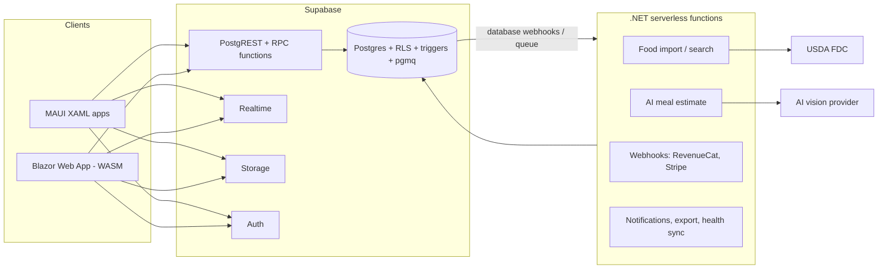
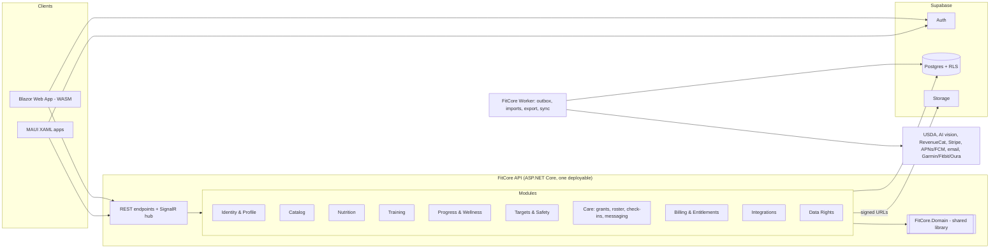
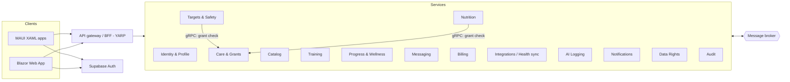

# Architecture Options: FitCore

- **Status:** Proposal, for a decision by the product owner
- **Date:** 2026-10-13
- **Input:** [`docs/BRD.md`](BRD.md), especially [§3 Permissions](BRD.md#3-permissions), [§5 Platform](BRD.md#5-platform-and-technology-constraints), [§6 Business rules](BRD.md#6-business-rules), [§7 Compliance](BRD.md#7-compliance-and-constraints) and [§9 Non-functional requirements](BRD.md#9-non-functional-requirements)

This document proposes three architecture options for FitCore, compares them against the business and non-functional requirements, and recommends one.

---

## 1. What the BRD already fixes

Some choices are already made, so every option keeps them:

| Area | Fixed by the BRD |
|---|---|
| Clients | .NET MAUI apps with native XAML on iOS, Android, Windows and macOS, and a Blazor Web App on the web. Two UIs share view models, service clients and the domain library. |
| Domain logic | One shared C# library for units, nutrition totals, estimated cost, targets and guardrails |
| Data platform | Supabase: Postgres, Auth, Storage and row-level security (RLS) |
| Server logic | ASP.NET Core services |
| Sign-in | Email/password, Google, Microsoft and Sign in with Apple |
| Access control | RLS on every private table, with pgTAP tests for cross-user access. Professionals get access only through active grants. Admins never see diaries. |

So the options differ in three ways. They put the business rules in different places (Postgres or .NET), split the server differently, and route client traffic differently.

### 1.1 Requirements that drive the architecture

These requirements shape the architecture most. The other NFRs, such as accessibility, mostly affect UI work and come out about the same in every option.

1. **Server-side enforcement of the safety rules.** Clients can't be trusted. Soft limits, the hard floor, pending coach targets and logged overrides ([BRD §6.2](BRD.md#62-targets-and-safety)) must be enforced on the server. The shared C# library only gives a client-side preview.
2. **Grant-aware authorization.** Access depends on the role and on scopes in a per-member grant. Revoking a grant takes effect immediately, and every professional edit is audited ([BRD §3](BRD.md#3-permissions)).
3. **Snapshots and "unknown is not zero".** Log entries keep their nutrients and cost from log time. Unknown values stay null all the way through, from storage to the totals.
4. **Offline workout logging** that syncs later without creating duplicates.
5. **A growing list of integrations:** USDA, AI vision, HealthKit, Health Connect, Garmin, Fitbit, Oura, RevenueCat, Stripe Connect, push, email and calendar.
6. **A compliance path.** Consumer health privacy law applies now. HIPAA applies in the Clinic phase.
7. **Gating by tier later without a redesign**, because pricing is still undecided.
8. **Team size.** The archived platform decision called the team small. Two separate UIs already take a large share of its capacity.

---

## 2. Option A: Supabase-first serverless

The clients talk to Supabase directly. Postgres holds the data, the authorization and the business rules. Small .NET serverless functions do only the work Postgres can't: outbound integrations and webhooks.



### A.1 Architecture style

Serverless with a backend-as-a-service. Supabase's Data API (PostgREST), Realtime and Storage are the backend. Supabase Edge Functions run Deno, not .NET, so the ASP.NET Core logic runs as .NET functions on AWS Lambda (Native AOT or SnapStart) or Azure Functions (isolated worker).

### A.2 Project structure and boundaries

```text
src/
  FitCore.Domain/          shared rules (client-side preview and table tests)
  FitCore.Client.Core/     view models, supabase-csharp data access, offline store
  FitCore.Maui/            XAML app
  FitCore.Web/             Blazor Web App
  FitCore.Functions/       one function per integration or webhook
supabase/
  migrations/              tables, RLS, RPC functions, triggers
  tests/                   pgTAP: RLS and guardrail functions
```

Boundaries are **Postgres schemas and RPC functions**. Each business operation that must enforce a rule is a `security definer` function, such as `set_target()`, `accept_target()`, `grant_access()` or `log_food()`. Plain CRUD goes straight through PostgREST under RLS.

### A.3 Database and schema approach

- One Supabase Postgres project. Tables are grouped in schemas (`nutrition`, `training`, `progress`, `care`, `catalog`, `audit`) and exposed through the Data API.
- RLS on every table. A `care.has_grant(member_id, scope)` helper is used in each policy.
- Guardrails are written again in PL/pgSQL inside the RPC functions. The C# library still runs on the client for previews, so **the rules exist in two languages.**
- Snapshots are taken by `before insert` triggers on diary entries. Audit rows are written by triggers that read the actor from `auth.jwt()`.
- Background work runs on Supabase Queues (pgmq) or database webhooks (`pg_net`), which call the .NET functions.

### A.4 API design

- **REST through PostgREST** for CRUD, and **RPC** (`POST /rpc/...`) for rule-bearing operations.
- **Supabase Realtime** for messages and comments.
- **HTTP functions** for webhooks and integrations.
- There's no API contract owned by the team. The database schema is the contract, so a schema change can break released mobile apps.

### A.5 Authentication and authorization

- Supabase Auth with the Email, Google, Azure (Microsoft) and Apple providers. A Custom Access Token Hook adds an `app_role` claim (member, coach, clinician, admin).
- On mobile, MAUI's `WebAuthenticator` runs the OAuth PKCE flow. On iOS, native Sign in with Apple gets an ID token, which is exchanged with Supabase's `signInWithIdToken`.
- **RLS is the only authorization layer.** Policies check the role, the grant scope and the MFA level: `auth.jwt()->>'aal' = 'aal2'` for professionals and admins.
- Admins get catalog write policies and no diary policies.

### A.6 Deployment model

- Supabase manages Postgres, Auth, Storage and Realtime, with separate staging and production projects.
- The .NET functions run on Lambda or Azure Functions, in the same cloud region as the Supabase project.
- The Blazor web client is WebAssembly on static hosting or a CDN. The apps ship through the three app stores.
- No servers to run, and costs scale down to zero.

### A.7 Evaluation

| | |
|---|---|
| **Pros** | Fastest path to the private beta. Least infrastructure. Lowest cost at small scale. One authorization model (RLS) on every path. Revocation is immediate, because policies read the live grant table. Reuses the R1 prototype's schema, RLS and pgTAP tests almost as they are. |
| **Cons** | Business rules live in **two languages** (C# and PL/pgSQL), which invites drift in exactly the safety rules that most need to be right. Complex workflows such as the coaching loop, check-ins, plan assignment and data export get hard to build and test in SQL. The C# Supabase client is community-maintained, which is a risk for a .NET-only stack. The schema is the public API, so clients and schema are tightly coupled, and releases have to be coordinated through app-store review. Strong lock-in to Supabase. .NET functions have cold starts. |
| **NFRs satisfied** | Privacy and access control (strong: RLS on every path, pgTAP). Data rights (adequate). Cost at low scale (strong). Offline sync (adequate: PostgREST upserts on client-generated UUIDs). |
| **NFRs traded off** | Maintainability and correctness of the guardrails (duplicated logic). Evolvability toward the Coach/Pro and Clinic phases. API stability for mobile clients. Observability, because logic spread across SQL and functions is hard to trace. |
| **Team** | 2–4 engineers. Strong Postgres skills (RLS, PL/pgSQL, pgTAP) are essential. Few .NET backend skills needed. |
| **Complexity** | **Low** for the private beta, rising to **high** by the Coach/Pro tier as SQL takes on workflow logic. |

---

## 3. Option B: Modular monolith on ASP.NET Core, with Supabase as the data platform

One ASP.NET Core application, split into strict modules, owns every business operation and runs the shared C# domain library on the server. Supabase provides Postgres, Auth and Storage. RLS stays in place as a second, independent layer of protection.



### B.1 Architecture style

**Modular monolith.** There's one API deployable and one worker deployable, built from the same solution. Each module owns its tables and exposes only a public interface and integration events. Architecture tests stop one module from reaching into another module's internals.

### B.2 Project structure and boundaries

```text
src/
  FitCore.Domain/               shared rules: units, totals, cost, targets, guardrails (no I/O)
  FitCore.Contracts/            request/response DTOs and the typed API client (shared by both UIs)
  FitCore.Client.Core/          view models (MVVM), offline store (SQLite), sync engine
  FitCore.Maui/                 XAML app, HealthKit / Health Connect bindings
  FitCore.Web/                  Blazor Web App host
  FitCore.Web.Client/           Blazor WebAssembly components
  FitCore.Api/                  composition root: auth, endpoint mapping, SignalR
  FitCore.Worker/               background host: outbox dispatcher, scheduled jobs
  Modules/
    FitCore.Modules.Identity/   profile, age gate, roles, preferences
    FitCore.Modules.Catalog/    shared and custom foods and exercises, USDA import, admin curation
    FitCore.Modules.Nutrition/  diary, snapshots, recipes, saved meals, planner, groceries, purchases
    FitCore.Modules.Training/   workouts, templates, programs, PRs, training load, offline sync
    FitCore.Modules.Progress/   weight, measurements, photos, wellness, adaptive-target proposals
    FitCore.Modules.Targets/    target estimates, guardrails, overrides, acceptance, precedence
    FitCore.Modules.Care/       grants and scopes, roster, plan assignment, comments, check-ins, messaging
    FitCore.Modules.Billing/    entitlements (RevenueCat), coach billing (Stripe Connect)
    FitCore.Modules.Integrations/ AI vision, health-platform and device sync, calendar, notifications
    FitCore.Modules.DataRights/ export, import (MyFitnessPal), account deletion
    FitCore.Modules.Audit/      audit log queries and the member-visible audit view
supabase/
  migrations/                   SQL migrations, the only schema source of truth
  tests/                        pgTAP: RLS and cross-user access for every table
tests/
  FitCore.Domain.Tests/         table tests for every rule in BRD §6
  FitCore.Modules.*.Tests/      module tests against a local Supabase stack
  FitCore.Architecture.Tests/   module boundary rules
```

Each module follows the same layout: a public `*.Contracts` folder (interfaces and events) and internal vertical slices (endpoint → handler → domain → persistence). Modules call each other only through those contracts, in process. Side effects that cross modules, such as "target accepted → notify coach", go through a **transactional outbox** that the worker dispatches.

### B.3 Database and schema approach

- **One Supabase Postgres database with a schema per module:** `identity`, `catalog`, `nutrition`, `training`, `progress`, `targets`, `care`, `billing`, `integration`, `audit`. A module only reads and writes its own schema. Cross-module reporting goes through views it owns.
- **Supabase CLI SQL migrations** are the single schema source. They keep RLS and pgTAP in the same place and let the R1 prototype's schema and tests carry over. EF Core or Dapper map onto the schema but don't generate it.
- **RLS stays in force for API traffic.** For each request, the API opens a transaction, switches to the `authenticated` role and sets `request.jwt.claims` from the caller's validated token. A bug in the API can't leak another member's rows. Only a few jobs use a privileged connection, each with its own credentials: catalog import, webhooks, deletion and export.
- **Key tables, mapped to BRD rules:**
  - `care.relationships`: member, professional, role, `scopes text[]`, status, granted and revoked timestamps. RLS helper: `care.has_grant(member_id, scope)`.
  - `targets.targets`: `set_by` (member, coach, clinician), `state` (pending, accepted, superseded), `below_soft_limit`, `below_hard_floor` and `source_relationship_id`.
  - `nutrition.diary_entries`: a client-generated UUID and nullable nutrient snapshot columns, because null means unknown. Cost snapshots are stored as `cost_minor bigint` plus `currency char(3)`.
  - `nutrition.diary_days`: `status` (complete or incomplete). A missing row means unknown.
  - `audit.events`: append-only, written by triggers in the same transaction as the change. Members read their own events.
- **Storage:** progress photos sit in a private bucket. The API checks the photo scope, then issues short-lived signed URLs.
- The Supabase Data API (PostgREST) is turned off or limited to `public`, so the only way in is the FitCore API.

### B.4 API design

- **REST + OpenAPI**, versioned under `/v1`, using ASP.NET Core minimal APIs and the built-in OpenAPI document generation. Both UIs use one typed C# client in `FitCore.Contracts`.
- **Guardrails as a protocol.** For example, `POST /v1/targets` either succeeds or returns `422 ProblemDetails` with a code such as `target.below_soft_limit` and a warning ID. The client resends with `acknowledgedWarningId` to override, and the override is logged. Hard-floor violations return `403` for members and coaches.
- **Idempotency.** Creates use client-generated UUIDs. `POST /v1/sync/workouts` accepts a batch of offline changes and upserts on the client UUID, so a retry never duplicates.
- **SignalR** for messaging, comments and check-in updates. It needs a backplane (Redis or a managed SignalR service) once the API runs on more than one instance.
- **Inbound webhooks** for RevenueCat, Stripe and the device vendors, with signatures verified, are written to an inbox table and processed by the worker.
- **Not GraphQL.** Both consumers are first-party C# clients, and field-level grant scoping is harder to get right in GraphQL. **Not gRPC** to clients, because the web would need gRPC-Web and it adds little for this workload.

### B.5 Authentication and authorization

- **Authentication:** Supabase Auth, the same as in Option A: four providers, native Sign in with Apple on iOS, PKCE through `WebAuthenticator`, and tokens in `SecureStorage`. The API validates Supabase JWTs against the project's JWKS (asymmetric signing keys).
- **Authorization works in three layers:**
  1. **Role and entitlement policies** in ASP.NET Core (`RequireRole("coach")`, `RequireEntitlement("meal-planner")`). Tier gating becomes a configuration change.
  2. **Resource-based grant checks.** A `GrantAuthorizationHandler` reads `care.relationships` live, without caching, so revocation takes effect immediately. It applies the [permission matrix](BRD.md#32-permission-matrix): professionals can write only targets, plans, comments, messages and check-in responses.
  3. **Postgres RLS** as an independent second check, tested with pgTAP.
- **MFA:** Supabase TOTP MFA is required for coach, clinician and admin. Policies require `aal2`.
- **Admin:** a separate internal Blazor admin app calling `/admin/v1` endpoints that only reach the catalog and account metadata. The admin database role has no privileges on diary, progress or wellness tables, so the "no diary browsing" rule holds even if the code is wrong.

### B.6 Deployment model

- **Containers:** `fitcore-api`, `fitcore-worker` and `fitcore-web` (the Blazor host), built from one solution with one CI pipeline.
- **Hosting:** a managed container platform in the **same region as the Supabase project**. Supabase runs on AWS, so ECS on Fargate in the same AWS region keeps database latency low. Azure Container Apps is a reasonable alternative if the team prefers Azure.
- **Environments:** local (.NET Aspire AppHost and the Supabase CLI stack), preview (Supabase branching per pull request), staging and production.
- **CI:** domain table tests, module tests, pgTAP (`supabase test db`) and architecture tests on every pull request. MAUI store builds run on macOS and Windows runners.
- **Clinic phase:** deploy a second **"clinic cell"** from the same images, on a Supabase project covered by a BAA (Supabase offers BAAs on its paid plans; confirm current terms) and BAA-covered compute. Consumer members stay outside HIPAA scope.

### B.7 Evaluation

| | |
|---|---|
| **Pros** | **One implementation of the rules.** The same C# domain library runs on the client for previews and on the server for enforcement, with one set of table tests. Two independent authorization layers (the API and RLS). A stable, versioned API protects released mobile apps from schema changes. Complex workflows (coaching loop, check-ins, export and deletion, adaptive targets) are ordinary C#, easy to test and debug. One deployable and one database keep operations, transactions and auditing simple. Clear module seams let a module become a service later if it ever needs to. |
| **Cons** | More to run than Option A: two or three always-on containers, a SignalR backplane and an outbox. Every client call goes through the API, so it has to scale and stay available. Module discipline has to be enforced (architecture tests, code review), or the monolith tangles. Setting per-request RLS claims adds a little latency and needs care with connection pooling. |
| **NFRs satisfied** | Privacy and access control (strong: RLS plus API policies, pgTAP). Security (strong: secrets only on the server, AI and payment keys never on devices, MFA, trigger-based audit in the same transaction). Reliability (strong: idempotent sync, ProblemDetails errors the clients can recover from without losing form state). Data rights (strong: each module adds to export and erasure). Compliance evolution (strong: the clinic cell). Tier gating (strong). Platforms (strong: one typed client for MAUI and Blazor). |
| **NFRs traded off** | Cost at very low scale (always-on compute, though small). Scaling isn't independent per module (acceptable at expected volumes). Availability depends on one API deployable, so it needs at least two instances and health checks. |
| **Team** | 4–8 engineers: 2–3 MAUI/XAML, 1–2 Blazor, 2 backend (ASP.NET Core, Postgres and RLS) and part-time DevOps. One developer can work across layers, because everything is C# and SQL. |
| **Complexity** | **Medium**, and it stays medium as features grow. |

---

## 4. Option C: Microservices

Each bounded context is its own ASP.NET Core service with its own data, behind an API gateway. Services talk to each other over gRPC and events.



### C.1 Architecture style

**Microservices**, with about 12–14 services split along the BRD's feature areas. The gateway or backend-for-frontend (YARP) handles routing, token validation and response composition. A broker (Amazon SNS and SQS, Azure Service Bus or RabbitMQ) carries integration events, and each service has an outbox.

### C.2 Project structure and boundaries

```text
services/
  identity/  catalog/  nutrition/  training/  progress/  targets/  care/
  messaging/  billing/  integrations/  ai-logging/  notifications/  data-rights/  audit/
    src/ tests/ Dockerfile  (one repository folder or repository per service)
gateway/                  YARP BFF
clients/                  FitCore.Domain, Client.Core, Maui, Web (as in Option B)
platform/                 Helm charts or Bicep/Terraform, observability, shared building blocks
contracts/                protobuf (gRPC) and event schemas, versioned
```

Each service owns its API, its data and its release cadence. The shared domain library is published as a versioned NuGet package that both the services and the clients use.

### C.3 Database and schema approach

- **A database per service.** Supabase supplies Auth and Storage. The service databases are either separate Postgres instances (Amazon RDS or Azure Database for PostgreSQL) or separate schemas with separate credentials, if they stay on Supabase.
- RLS can still run inside each service's database, but **grants live in the Care service.** Other services either:
  - call Care synchronously (gRPC) on every request, which adds latency and turns Care into a dependency that every request needs, or
  - keep a local copy of the grants, updated by `GrantChanged` events, which is **eventually consistent.** That conflicts with the BRD's "revocation is effective immediately."
- The audit log and data export become cross-service problems, solved with an Audit service that consumes events and an export saga that calls each service.

### C.4 API design

- **REST** at the gateway for the clients, plus **SignalR** in the Messaging service.
- **gRPC** between services for synchronous queries, such as grant checks and catalog lookups.
- **Events** (CloudEvents format over the broker) for state changes, such as `DiaryDayCompleted`, `TargetAccepted` or `GrantRevoked`.

### C.5 Authentication and authorization

- Supabase Auth issues tokens, and the gateway validates them. Services trust the gateway, either through a token exchange for internal tokens or with mutual TLS and the token passed through.
- Grant authorization is centralized in Care and enforced by every service through a gRPC check or a cached projection. The MFA, admin and role rules are as in Option B, but have to be repeated in every service.

### C.6 Deployment model

- Kubernetes (EKS or AKS) or Azure Container Apps with Dapr. There's a pipeline per service, and observability is mandatory: OpenTelemetry, distributed tracing and centralized logs.
- The Clinic phase can isolate the services that handle PHI.

### C.7 Evaluation

| | |
|---|---|
| **Pros** | Each service scales and deploys on its own. Faults are isolated (for example, an AI-logging outage doesn't touch diary writes). Teams can be autonomous at a large headcount. The services that handle PHI can be isolated for HIPAA. |
| **Cons** | **Distributed grant enforcement** clashes with immediate revocation, a fixed BRD requirement. Audit, export and deletion become distributed sagas. Many deployables and pipelines, plus a broker and tracing, for a product that hasn't launched. Two client UIs already strain a small team. Microservices would multiply the operational load before any product-market fit. Operating cost is much higher. |
| **NFRs satisfied** | Scalability and fault isolation (strong, though the BRD sets no targets yet). Compliance isolation (strong). |
| **NFRs traded off** | Privacy and access control (harder to prove, because grant checks are spread across services and pgTAP coverage is fragmented). Data rights (sagas). Security (a larger attack surface, and service-to-service trust to manage). Reliability (partial failures, retries, eventual consistency). Cost. Time to market. |
| **Team** | 15+ engineers in 3–4 stream-aligned teams, plus a platform/SRE team. Needs experience with Kubernetes, messaging, distributed tracing and eventual consistency. |
| **Complexity** | **High** from day one. |

---

## 5. Side-by-side comparison

| Criterion | A: Supabase-first serverless | B: Modular monolith | C: Microservices |
|---|---|---|---|
| Where rules are enforced | PL/pgSQL (duplicated from C#) | Shared C# library on the server | Shared C# library, spread across services |
| Authorization layers | RLS | API policies + RLS | Gateway + per-service checks (+ RLS) |
| Immediate grant revocation | Yes | Yes | Only with a synchronous check on every request |
| Audit of professional edits | Triggers | Triggers in the same transaction, plus a module view | Distributed, event-sourced |
| Offline sync without duplicates | Upsert on client UUID | Batch sync endpoint, idempotent | Same as B, in the Training service |
| API stability for app-store clients | Weak (schema is the API) | Strong (versioned REST) | Strong |
| Integrations (AI, payments, health) | Functions | Modules + worker | Dedicated services |
| HIPAA path (Clinic phase) | Supabase BAA + function host BAA | Separate clinic cell | Isolate PHI services |
| Gate features by tier later | RLS + entitlement table | Entitlement policies | Per-service entitlement checks |
| Operational load | Lowest | Low to moderate | High |
| Cost at beta scale | Lowest | Low | High |
| Time to private beta | Fastest | Fast | Slow |
| Team size | 2–4 | 4–8 | 15+ |
| Complexity | Low → high | Medium | High |

### 5.1 NFR coverage

| NFR ([BRD §9](BRD.md#9-non-functional-requirements)) | A | B | C |
|---|---|---|---|
| Privacy and access control: RLS, pgTAP, grants only, no admin diary access | Strong | Strong | Adequate |
| Security: secrets on the server, TLS, encryption at rest, MFA, audit | Adequate | Strong | Adequate |
| Reliability: no lost form state, offline sync without duplicates | Adequate | Strong | Adequate |
| Accessibility (WCAG 2.2 AA, VoiceOver, TalkBack) | Same in all options: UI work in XAML and Razor | Same | Same |
| Platforms (iOS, Android, Windows, macOS, web) | Strong | Strong | Strong |
| Data retention: export and deletion | Adequate | Strong | Weak |
| Measurable targets: availability, performance, scalability, cost (TBD) | Low cost; scales with Supabase | Meets likely targets; scales by adding instances | Most scalable, highest cost |
| Maintainability of the safety rules | Weak | Strong | Adequate |

---

## 6. Recommendation: Option B, the modular monolith

Build FitCore as a **modular monolith on ASP.NET Core (.NET 10 LTS)**, with Supabase as the data, authentication and storage platform, and RLS kept as an independent second layer of protection.

### 6.1 Why

1. **The safety rules need one source of truth.** FitCore's riskiest requirements are the soft limits, the clinician-only hard floor, pending coach targets, logged overrides and the ED-flag lockout. Option B runs the same tested C# library on the device for previews and on the server for enforcement. Option A would write these rules a second time in PL/pgSQL. Every clinical-review change would then have to land identically in two languages.
2. **Privacy is defended twice.** API policies apply the permission matrix, and RLS, running with the caller's own claims, enforces it again in the database. A bug in either layer alone can't expose a member's diary. Option C would weaken this by spreading grant checks across services, and couldn't revoke grants immediately without a synchronous check on every call.
3. **It fits the team.** The product owner chose two native UIs, so most engineering capacity goes to the clients. One backend deployable, one database and one language keep the backend small enough for two engineers. Option C needs a team several times larger.
4. **Released apps need a stable contract.** App-store review delays mobile releases, so the server has to stay compatible with older app versions. A versioned REST API absorbs schema changes. Option A's "the schema is the API" doesn't.
5. **It scales with the roadmap without a rewrite.** Each module maps to a BRD feature area. The Coach/Pro tier adds to the Care and Billing modules. The Clinic phase deploys a separate HIPAA-covered cell from the same code. If one module ever needs to scale or fail on its own (AI logging or health sync are the likely ones), its contract and schema already form a clean seam to extract it as a service.
6. **It keeps what R1 earned.** The SQL migrations, RLS policies and pgTAP tests carry over directly. Option B adds the grant-aware policies that [BRD §11](BRD.md#11-changes-from-the-r1-prototype) asks for.

### 6.2 What to borrow from the other options

- From **A**: keep Supabase-managed Auth, Storage, branching and migrations, and run the API under RLS rather than as a superuser. For the private beta, the worker can stay inside the API process. Split it out once background load grows.
- From **C**: send cross-module side effects through an outbox and integration events from day one. Architecture tests stop shortcuts between modules. That keeps a later extraction mechanical.

### 6.3 Risks and mitigations

| Risk | Mitigation |
|---|---|
| Modules tangle over time | Schema per module with separate grants, architecture tests in CI, and contracts-only references |
| Per-request RLS claims interact with connection pooling | Use `set local` inside each request's transaction. Connect through Supavisor session mode or a direct connection with Npgsql pooling. Load-test early. |
| The API becomes a single point of failure | At least two instances, health checks, and a SignalR backplane before the Coach/Pro tier |
| Grant checks add load | Index `care.relationships`. Don't cache grants (revocation must be immediate). Measure before optimizing. |
| Lock-in to Supabase | Only standard Postgres features are used (RLS, SQL migrations), and auth is plain OIDC/JWT, so moving off Supabase is possible later |

### 6.4 Next steps

1. Record this choice as an architecture decision record (ADR) once the product owner agrees.
2. Set the measurable NFR targets ([BRD §9](BRD.md#9-non-functional-requirements)): availability, p95 latency for diary writes and the Today screen, and expected members per year. Size instances and the database against them.
3. Spike the two riskiest mechanics: per-request RLS claims through EF Core or Npgsql with Supavisor, and Sign in with Apple to Supabase from MAUI.
4. Build the private beta from the Identity, Catalog, Nutrition, Targets and Progress modules. Put the `care.relationships` table and grant-aware RLS in place from the start, even before the Coach/Pro tier ships.
